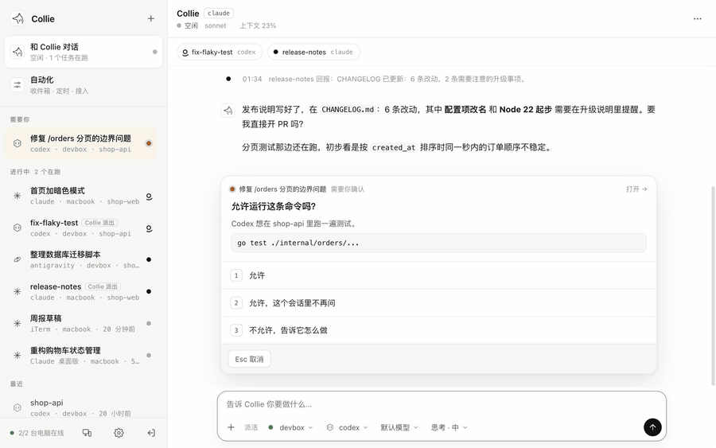
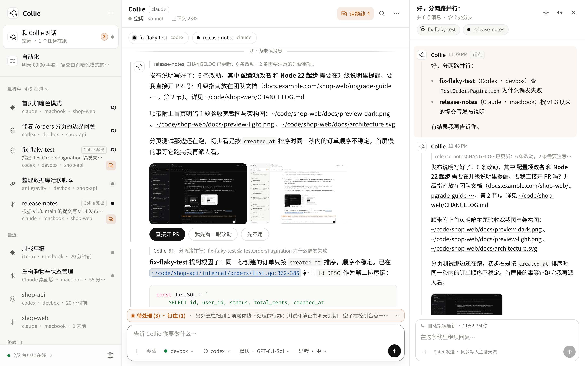
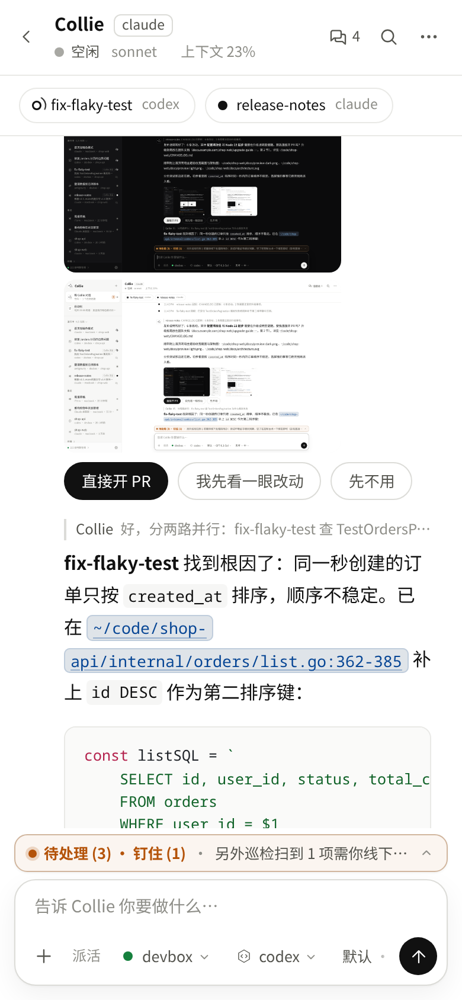
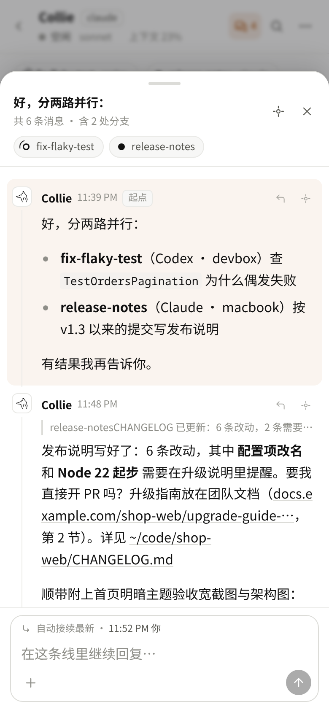
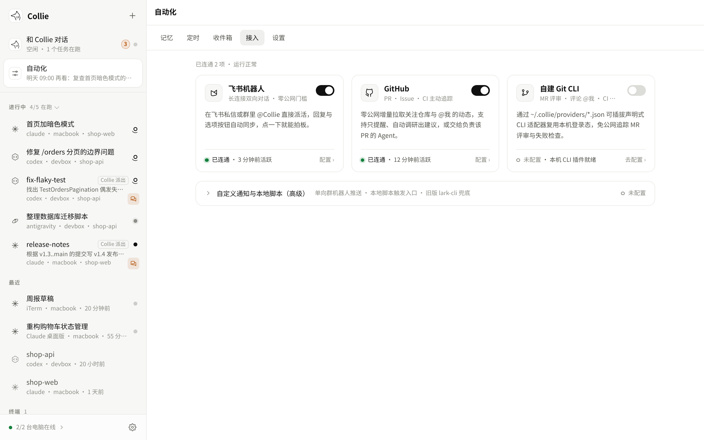
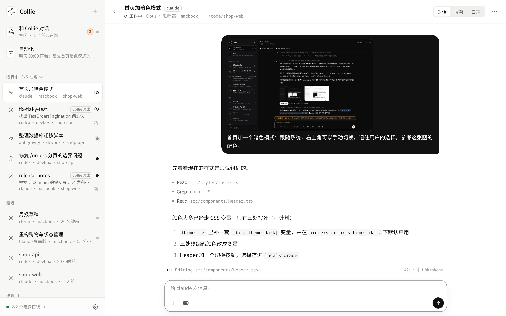
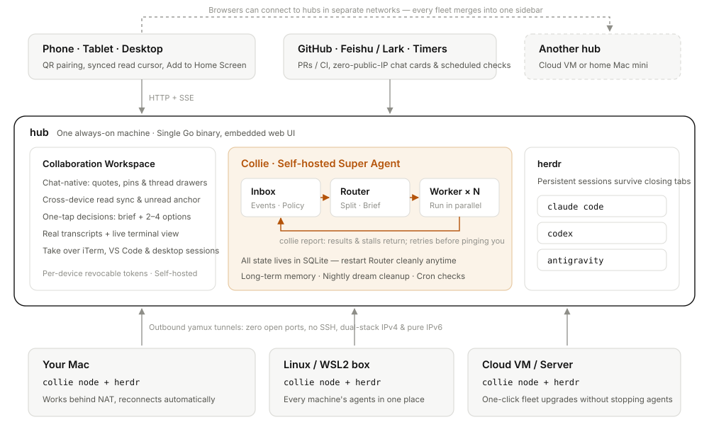

<p align="center"></p>

<h1 align="center">Collie</h1>

<p align="center"><sub>One border collie to herd your coding agents</sub><br>
<b>Stop running a 20x AI plan at 1x. Turn 20x quota into 20x output.</b><br>
Open-source, self-hosted Super Agent for Antigravity (Gemini), Claude Code, Codex, and Cursor — push a dozen parallel tracks, get 3-line briefs and one-tap decisions.</p>

<p align="center">
<a href="https://lihuanyu0w0.github.io/collie/demo/"><b>▶ Live Demo (10s)</b></a> ·
<a href="https://www.bilibili.com/video/BV1a41EziEsE/"><b>▶ Video Walkthrough (Bilibili)</b></a> ·
<a href="https://lihuanyu0w0.github.io/collie/">Homepage</a> ·
<a href="#quick-start">Quick Start (30s)</a> ·
<a href="https://github.com/lihuanyu0w0/collie/releases">Releases</a> ·
<b>English</b> | <a href="README.zh-CN.md">中文</a>
</p>

<!-- Hero showcase animated demo -->
<p align="center">
<a href="https://lihuanyu0w0.github.io/collie/demo/">
  
</a>
</p>

<p align="center">
<b><a href="https://www.bilibili.com/video/BV1a41EziEsE/">▶ Watch the full 3-minute video walkthrough on Bilibili →</a></b>
</p>

> **Solo Antigravity is one agent. Paired with Collie, it becomes your dedicated Gemini command deck** — multi-terminal herding, long-running follow-through, and mobile control (alongside Claude Code, Codex, and Cursor).

Paying for **Claude Max 20x** or **Codex Pro 20x** while babysitting one terminal at a time still caps you at 1x output. **Collie** is an open-source, self-hosted **Super Agent** that turns 20x quota into **20x real output**—herding Antigravity, Claude Code, Codex, and Cursor across your Macs, Linux devboxes, and cloud VMs in one unified workspace (no more juggling terminal tabs or separate agent desktop apps, while still letting you take over any session already running). One person can push **a dozen parallel tracks at once**—research, coding, long-running jobs, and releases—while Collie tracks progress, retries stalls, and comes back with **a 3-line summary and 2–4 one-tap options**, so you only step in for the key calls. Because Collie is **one pure Web UI** (Add to Home Screen as a PWA) with identical full capabilities on phone and desktop—delegate, read briefs, tap decisions, open thread drawers, inspect images and reports—you can **leave your laptop behind** on commutes, trips, or between meetings.

> Named after the border collie: [herdr](https://herdr.dev) keeps the terminals alive; Collie herds the agents.

## Why Collie

- **Ditch terminals & agent desktop apps—delegate once, decide in one tap** — No more switching between terminals, Claude Desktop, Codex Desktop, and Antigravity Desktop. One workspace runs every agent across your machines, retries stalls, and surfaces 3-line briefs with tap-ready choices (`Open PR`, `Review diff first`, `Skip`).
- **One pure Web UI across phone & desktop—leave your laptop behind** — Phone (PWA) and desktop share the exact same full experience, not a watered-down remote. Quote-reply, **Pin** conclusions and todos, browse resizable **thread drawers**, paste images or inspect full reports, and stay anchored at your **synced cross-device unread boundary**—ship real work from your phone anywhere.
- **Events come to you automatically** — Wire in **GitHub** (PR reviews, `@mentions`, and CI failures trigger read-only investigation and push a brief + one-tap merge/fix options), **Feishu / Lark** (zero-public-IP WebSocket long connection with two-way interactive cards), scheduled cron patrols, and nightly memory consolidation (**dream**).
- **All your machines, zero open ports** — Connect Macs, Linux devboxes, WSL2, and cloud VMs to one hub over outbound multiplexed tunnels (`yamux`) with automatic IPv4 and pure-IPv6 discovery. No SSH, no open ports, works behind NAT, and federates multiple isolated hubs into one sidebar.
- **Step into any agent—or take over existing ones** — Inspect native `JSONL` transcripts directly or flip to the live `xterm.js` screen anytime (even terminal confirmation prompts turn into quick tap cards when you step in). Auto-discovers sessions already running in iTerm, VS Code, tmux, SSH, or desktop apps for live viewing and one-click takeover.
- **Single binary, 30-second setup, fully yours** — One Go binary + SQLite + embedded web UI (zero CDN, zero third-party cloud). Per-device revocable tokens, one-click rolling fleet updates without touching running agents, and one-click ZIP export/import for long-term memory.

<table>
<tr>
<td width="64%">
<picture>
  <source media="(prefers-color-scheme: dark)" srcset="docs/img/thread-dark.png">
  <source media="(prefers-color-scheme: light)" srcset="docs/img/thread-light.png">
  
</picture>
<br><sub><b>Chat-native collaboration</b>: unread boundary anchor, one-tap decisions, pinned todos, and resizable thread drawer</sub>
</td>
<td width="18%">
<picture>
  <source media="(prefers-color-scheme: dark)" srcset="docs/img/phone-decision-dark.png">
  <source media="(prefers-color-scheme: light)" srcset="docs/img/phone-decision-light.png">
  
</picture>
<br><sub><b>Phone</b>: tap once to decide</sub>
</td>
<td width="18%">
<picture>
  <source media="(prefers-color-scheme: dark)" srcset="docs/img/phone-thread-dark.png">
  <source media="(prefers-color-scheme: light)" srcset="docs/img/phone-thread-light.png">
  
</picture>
<br><sub><b>Thread sheet</b>: parallel tasks stay clean</sub>
</td>
</tr>
<tr>
<td width="50%" colspan="1">
<picture>
  <source media="(prefers-color-scheme: dark)" srcset="docs/img/integrations-dark.png">
  <source media="(prefers-color-scheme: light)" srcset="docs/img/integrations-light.png">
  
</picture>
<br><sub><b>Event-driven integrations</b>: Feishu / Lark two-way cards, GitHub PR/CI tracking, and custom CLI forges</sub>
</td>
<td width="50%" colspan="2">
<picture>
  <source media="(prefers-color-scheme: dark)" srcset="docs/img/agent-dark.png">
  <source media="(prefers-color-scheme: light)" srcset="docs/img/agent-light.png">
  
</picture>
<br><sub><b>Direct agent control</b>: structured plan and edits parsed from native transcripts, plus one-click takeover</sub>
</td>
</tr>
</table>

More screenshots: [Memory & Dream](docs/img/memory-light.png) · [Live Terminal](docs/img/screen.png) · [Devices & Pairing](docs/img/devices.png) · [Try the 10-second Live Demo](https://lihuanyu0w0.github.io/collie/demo/)

## Quick Start

macOS, Linux (`amd64` / `arm64`), and Windows via **WSL2**. One command verifies SHA-256 checksums, installs `collie` to `~/.local/bin/collie`, installs [herdr](https://herdr.dev) if missing, and registers a background service (`launchd` or `systemd --user`). Re-running upgrades in place.

> **Windows (WSL2):** Run the exact same command inside a **WSL2 (Ubuntu / Debian)** terminal—it uses the Linux binary out of the box. If you only want to view or steer remote agents from Windows, open the hub URL in Chrome or Edge.

**1. Start a hub on an always-on machine (30s)**

```bash
curl -fsSL https://lihuanyu0w0.github.io/collie/install.sh | sh -s -- hub
```

Prints your auto-detected LAN addresses (IPv4 and pure IPv6) and a one-time QR code. Override the address with `--url http://<host>:7788` (or `http://[<ipv6>]:7788`). On Linux, run `loginctl enable-linger` once so the service survives logout.

**2. Pair your phone**

Scan the terminal QR code (or open *Devices → Connect phone or tablet*), then **Add to Home Screen** (use Safari on iOS for full PWA session persistence). Your read/unread cursor and pending decisions stay synced across phone and desktop automatically.

**3. Join your other computers**

Copy a pairing code from *Devices → Connect a computer* (or run `collie pair --computer` on the hub), then run on each machine:

```bash
curl -fsSL https://lihuanyu0w0.github.io/collie/install.sh | sh -s -- node --hub http://<hub>:7788 --code <code>
```

The node dials outbound to the hub (zero open ports, no SSH) and saves its revocable token in `~/.collie/node.json`. All machines merge into one fleet—remote panes carry a machine suffix like `w1:p1@mac`.

> **Integrations & security notes:** The installer sets up missing herdr integrations for Claude Code and Antigravity without overwriting existing configs, and skips Codex global hooks by default (Collie discovers, chats with, and resumes Codex natively without editing `~/.codex/hooks.json`; pass `COLLIE_INSTALL_CODEX_HOOK=1` if you explicitly want it). Hub traffic is plain HTTP on LAN—place it behind Tailscale/VPN or an HTTPS reverse proxy (`--url https://…`) for cross-network access.

**Keeping the fleet updated:** Tap **Update all** in the sidebar or *Devices*, or run `collie update` (alias `collie upgrade`) from any terminal—use `collie update --check` to inspect versions or `collie update --all` to upgrade remote nodes first (with automatic Hub relay fallback) and then the hub, without interrupting running agents.

## Architecture

<p align="center">
<picture>
  <source media="(prefers-color-scheme: dark)" srcset="docs/img/architecture-en-dark.svg">
  <source media="(prefers-color-scheme: light)" srcset="docs/img/architecture-en-light.svg">
  
</picture>
</p>

One **hub** runs on an always-on machine; other computers run `collie node` to dial out to the hub; phones, tablets, and browsers talk only to the hub. Agents live inside [herdr](https://herdr.dev), so closing the browser never stops them.

## How the Super Agent Works

```text
          ┌──────── You (Web chat / Feishu·Lark / GitHub / Cron timers …)
          ▼
   Trigger Inbox ── Fast path: per-source policy (respond / candidate / ignore)
          │
          ├── Subscribed worker ◀── direct delivery, bypasses Router
          ▼
   Router (persistent session: triage, dispatch, 3-line briefs + one-tap options)
          │  collie spawn / send / reply / timer …
          ▼
   Worker × N (isolated herdr workspaces across machines, report back via collie report)
```

- **Router / Worker split** — The Router only coordinates and briefs you (concise by default, configurable budget) so it runs cheaply on a fast model while Workers use your strongest coding models.
- **Inbox, thread subscriptions & batching** — Chats, GitHub PR/CI events, Feishu/Lark messages, webhooks, cron timers, and worker reports all land as **Triggers**. Unsolicited external events default to `candidate` (acted on only when covered by your rules or memory). Workers subscribed to a PR or thread receive follow-ups directly.
- **Inline & Spill** — Payloads over 700 chars inline a preview and spill the rest to `collie show <id>` so every event stays traceable without bloating context.
- **Watchdog, recovery & nightly dream** — Stalled workers trigger a watchdog alert so Collie retries or changes strategy before bothering you. All state lives in SQLite, while long-term knowledge lives in `~/.collie/router/memory/` (automatically tidied overnight and exportable/importable as a ZIP).

---

## Advanced & Reference

<details>
<summary><b>Multiple hubs, Mac desktop app &amp; install from source</b></summary>

### Multiple hubs across isolated networks

When machines sit in networks that cannot reach each other (office devbox, cloud VM, home Mac mini), run one hub per network. In your primary hub, open *Devices → Other hubs* and paste the pairing URL from another hub's *Connect phone or tablet*. Its sessions merge into the same sidebar (tagged by hub) and talk directly to that hub from your browser.

- Hubs do not need network connectivity to each other—only your browser needs to reach each hub.
- Remote hubs must be `v0.2.4+` (CORS token auth, no cookies). An HTTPS page cannot connect to a plain HTTP hub.

### Install as a desktop app on Mac

Any machine running `collie node` exposes the same web UI locally at `http://127.0.0.1:17788` (proxied to the hub). Because browsers treat `127.0.0.1` as a secure origin, open it in Chrome, pair once with an 8-character code, and click **Install Collie** in the address bar for a standalone Dock app with desktop notifications. Change the port with `collie node --ui 127.0.0.1:<port>`, or disable with `--ui off`.

### CLI upgrade &amp; install from source

Upgrade in place from any terminal (verifies SHA-256 checksums, replaces the binary atomically, and smoothly restarts active `systemd --user` or `launchd` services):

```bash
collie update --check   # check current vs latest version (read-only)
collie update           # update this machine (alias: collie upgrade; add --force to reinstall)
collie update --all     # upgrade all online remote nodes first, then the hub
```

You can also re-run the installer script (`… | sh -s -- node` needs no re-pairing; include any custom `--url` flags when upgrading `hub`).

To build and install from source (requires **Go 1.25+** and `git`):

```bash
git clone https://github.com/lihuanyu0w0/collie.git ~/collie && cd ~/collie
sh docs/install.sh hub                                         # run as hub
sh docs/install.sh node --hub http://<hub>:7788 --code <code>  # join as node
```

Binary only (no service): `curl -fsSL https://lihuanyu0w0.github.io/collie/install.sh | sh`. Pin a version or target directory with `COLLIE_VERSION=v0.2.85` or `COLLIE_BIN_DIR=…`. Full script: [docs/install.sh](docs/install.sh).

</details>

<details>
<summary><b>External integrations &amp; webhooks (GitHub, Feishu / Lark, CLI providers)</b></summary>

Configure integrations in **Automation → Integrations** (credentials are stored in `~/.collie/secrets.json` with `0600` permissions and never echoed back):

- **GitHub &amp; pluggable Git forges** — Built-in GitHub integration monitors PR reviews, `@mentions`, and CI failures in `notify`, `advise`, or `agent` mode with stable per-PR threads. Drop custom JSON definitions into `~/.collie/providers/*.json` to connect any CLI-backed code host.
- **Feishu / Lark (zero-public-IP WebSocket)** — Native long-connection client supports bidirectional chat and interactive decision cards with no public callback URL required; when directly `@`-mentioned in a group chat without quoting a parent message, granting the optional `im:message.group_msg` scope automatically attaches recent group context (gracefully degrading when not enabled). Event webhooks (`/hooks/feishu?key=…`, with `url_verification`) are also supported.
- **GitHub &amp; Generic Webhooks** — Copy URLs from *Automation → Integrations*:
  - GitHub webhook: `/hooks/github?key=…` (`application/json`)
  - Generic webhook: `POST /hooks/<source>?key=…` with JSON `{"text","thread","from","id"}` and optional `X-Idempotency-Key` deduplication. Webhooks return `202 Accepted` immediately and route asynchronously through the inbox.
- **Outbox notifications** — Optional Feishu / Lark or Slack notifications batched every 20 seconds; quiet mode only notifies when human input is needed.

</details>

<details>
<summary><b>Direct agent control, external terminal takeover &amp; herdr compatibility</b></summary>

- **Native transcript parsing** — Reads Claude (`~/.claude/projects/*/<id>.jsonl`), Codex (`~/.codex/sessions/**/rollout-*.jsonl`), and Antigravity (`~/.gemini/antigravity-cli/brain/<id>/…/transcript.jsonl` and desktop stores). For agents that don't emit a session ID to herdr, Collie pairs sessions exclusively by working directory and launch timestamp—falling back to terminal output rather than crossing wires.
- **Terminal prompt helper** — When you step directly into a terminal agent and it pauses on a confirmation prompt, Collie detects numbered and cursor menus and renders them as quick tap cards, with a toggle to inspect the raw terminal screen.
- **Sessions in other terminals** — Discovers Claude Code, Codex, and Antigravity processes running directly in iTerm, VS Code, tmux, SSH, or desktop apps on the hub and every connected node. View them live in read-only chat, or click **Take over in herdr** to gracefully interrupt and resume the exact session (`claude --resume`, `codex resume`, `agy --conversation`) under Collie's control.
- **Browser preferences** — Gear icon at the bottom of the sidebar (per-browser): theme (System / Light / Dark), font size, default agent view (Chat vs Screen), Enter vs ⌘Enter send, collapse consecutive tool steps, and desktop notifications.
- **herdr 0.8 &amp; 0.9 compatibility** — Supports both versions automatically, persisting agent names in `herd.db`, falling back to direct terminal paste when 0.8 stays in `launch_pending`, and inspecting the live screen for folder-trust prompts.

</details>

<details>
<summary><b>CLI reference</b></summary>

The Router, Workers, and you all use the same `collie` binary (on joined nodes, CLI commands automatically read `~/.collie/node.json` and talk to the hub):

```bash
collie reply [--re ID] [--opt "choice"]... [--check] "…"     # Router → you
collie spawn [-kind claude] [-machine mac] [-cwd ~/x] \
             [-model ID] [-effort E] [-name n] [-thread t] [-subscribe] "task"
collie send <worker> "follow-up"                             # message a running worker
collie report "summary or BLOCKED: question"                 # worker → Router (via HERDR_PANE_ID)
collie answer <worker> <number | label | esc>                # answer a worker's prompt
collie subscribe [--off] <worker> <thread>                   # route thread directly to worker
collie stop <worker>                                         # stop a worker
collie show <trigger-id | thread | worker>                   # fetch spilled content
collie list                                                  # list workers, threads, timers
collie timer add [--thread T] [--to worker] "<spec>" "text"  # daily/weekdays/weekly/every/in/at
collie timer ls | rm <id>
collie memory export [file.zip]                              # export router memory as ZIP
collie memory import [--replace] <file.zip>                  # merge or replace router memory
collie say "…"                                               # message Router as yourself
collie hook <source> "…"                                     # inject a test external event
collie pair [--computer]                                     # print phone QR / computer join command
collie node [--hub URL --code CODE] [--name mac]             # connect this machine to a hub
collie update [--check | --all | --force]                    # check or update collie (alias: upgrade)
```

</details>

<details>
<summary><b>Flags, environment variables &amp; <code>~/.collie</code> layout</b></summary>

Running `collie` (or `collie serve`) starts the hub, listening dual-stack on IPv4/IPv6. All frontend assets (including `xterm.js` and offline KaTeX) are embedded in the binary.

| Flag | Environment variable | Default |
|---|---|---|
| `-addr` | `COLLIE_ADDR` | `:7788` |
| `-socket` | `HERDR_SOCKET_PATH` | `~/.config/herdr/herdr.sock` |
| `-token` | `COLLIE_TOKEN` | Auto-generated master token |
| `-url` | `COLLIE_URL` | Auto-detected LAN IPv4/IPv6 URL for QR &amp; pairing |
| — | `COLLIE_HOME` | `~/.collie` |

> Anyone with a token can control your terminals. Keep the master token private; pair every other device so it gets its own revocable token (computer tokens can only open tunnels and call the CLI, never the web console).

| Path inside `~/.collie` | Purpose |
|---|---|
| `herd.db` | SQLite (WAL): trigger inbox, threads, workers, chat history, timers, settings, paired device token hashes |
| `node.json` | Node only: hub URL, machine ID, and node token |
| `token` / `addr` | Master access token and active listen address for local CLI calls |
| `secrets.json` | Integration secrets (`0600`, write-only in UI) |
| `providers/` | Optional custom Git-forge CLI provider definitions (`*.json`) |
| `router/` | Router workspace: `ROUTER.md` (mirrored to `CLAUDE.md` / `AGENTS.md` / `GEMINI.md`), `memory/` (long-term notes), and `dreams/` |

</details>

<details>
<summary><b>Build from source &amp; codebase layout</b></summary>

Requires **Go 1.25+**:

```bash
go build -o bin/collie .
./bin/collie                       # listens on :7788 (IPv4/IPv6 dual-stack)
go test ./...
scripts/release.sh v0.1.0 --dry    # cross-compile 4 platforms into dist/
```

```text
Browser ──HTTP + SSE──▶ collie hub (single Go binary, embedded web/) ──NDJSON──▶ herdr.sock
                          ├─ Incremental JSONL transcript parser
                          ├─ Super-agent: inbox → router → workers (SQLite)
                          ├─ Integrations: GitHub / CLI providers / Feishu·Lark WS / webhooks
                          └─ yamux tunnel ◀── collie node (herdr stream + local pane API)
```

```text
main.go              Entrypoint: version string + collie.Main
internal/collie/     Hub, node, super-agent, integrations, memory I/O, and CLI
web/                 Zero-build vanilla HTML/CSS/JS UI embedded via go:embed
docs/                install.sh, bilingual GitHub Pages site, demo/, and screenshots
scripts/release.sh   Cross-compilation and atomic draft GitHub releases
scripts/demo.sh      Builds docs/demo/ from the real frontend + mock data
```

</details>
