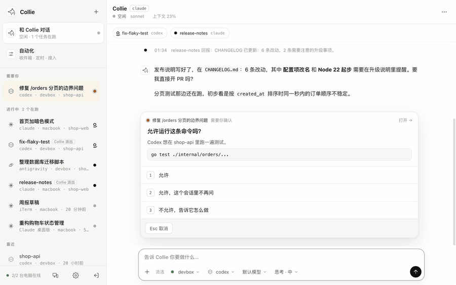
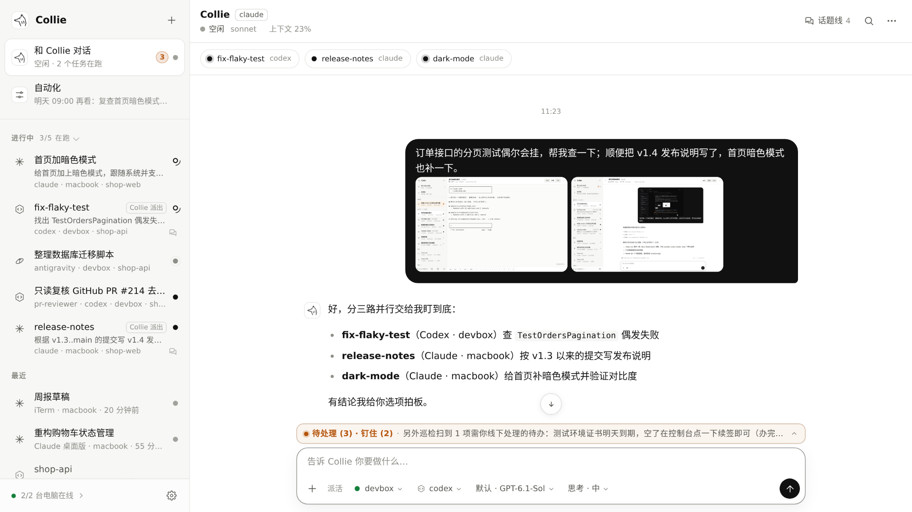
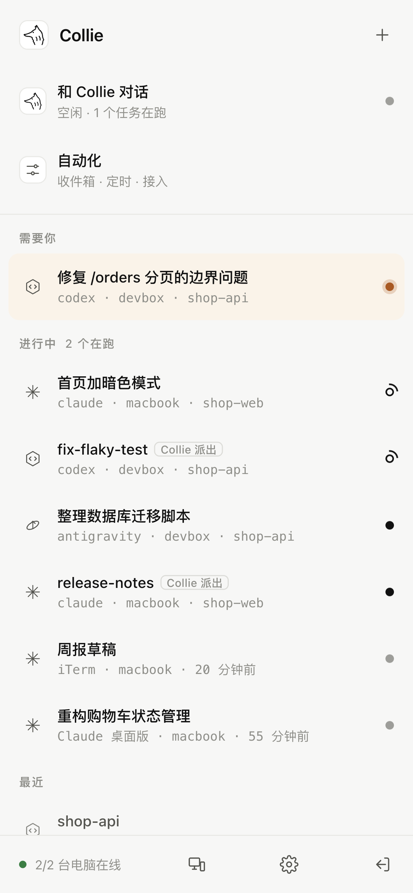
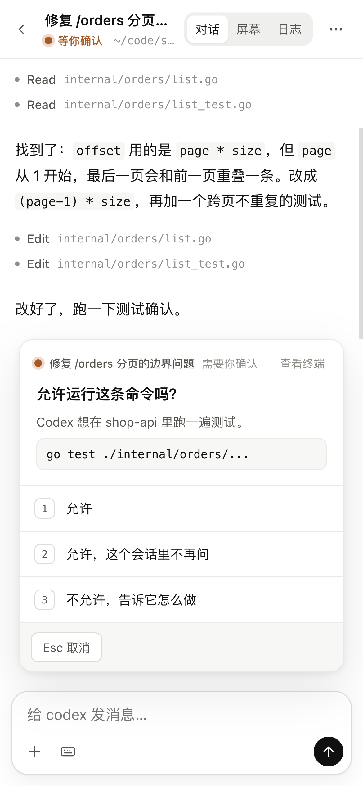
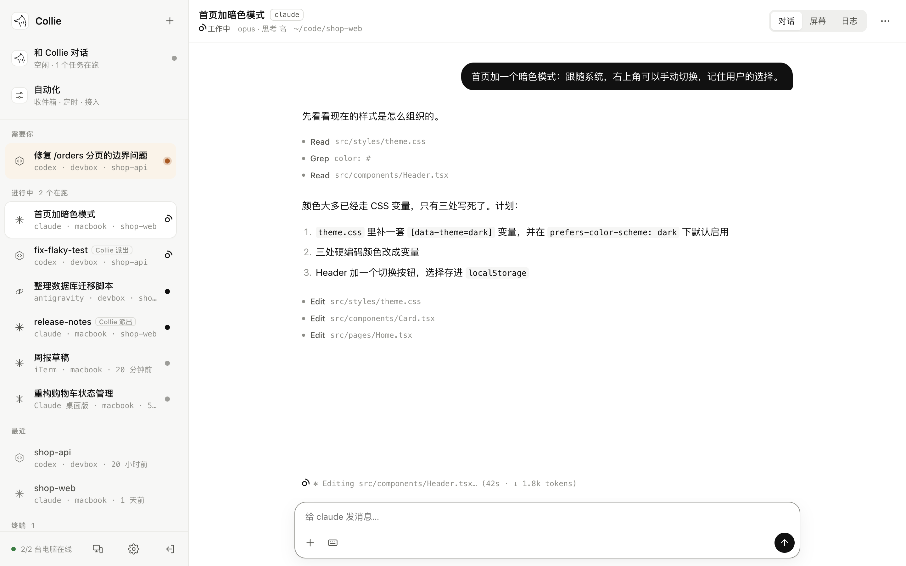
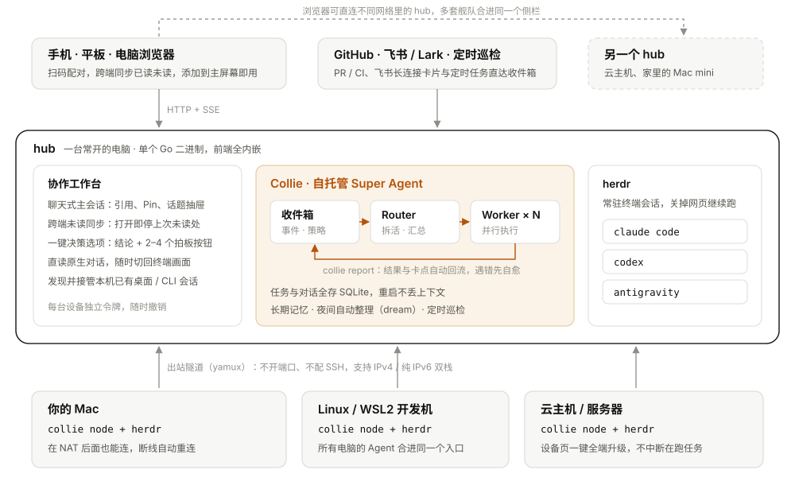

<p align="center"></p>

<h1 align="center">Collie</h1>

<p align="center"><b>在手机上养边牧，放牧一群 Agent</b><br>
Claude Code · Codex · Antigravity — 一个 hub，多台电脑，一个会自己推进的 super-agent</p>

<p align="center">
<a href="https://lihuanyu0w0.github.io/collie/demo/"><b>▶ 在线体验</b></a> ·
<a href="https://lihuanyu0w0.github.io/collie/">主页</a> ·
<a href="#快速开始">快速开始</a> ·
<a href="https://github.com/lihuanyu0w0/collie/releases">下载</a> ·
<a href="README.md">English</a> | <b>中文</b>
</p>

<p align="center"></p>

电脑上开着的 Claude Code、Codex、Antigravity 会话，手机上直接接着聊：看对话、发消息、处理确认框，需要你的时候叫你一声。活多了就交给 **Collie** 这个 super-agent：它把活派给各台电脑并行去做，盯进度、处理卡点，只在需要你拍板时出声。

> Collie 是一只边牧（border collie）：[herdr](https://herdr.dev) 管终端，Collie 把 agent 赶到一处干活。

## 为什么用 Collie

- **一个入口，派一群 agent** — 把事情告诉 Collie，它理解上下文、选 agent / 模型 / 电脑、拆活并行去做，结果回到同一个对话。
- **确认框变成卡片** — agent 停在「允许运行吗？」时，问题和选项变成一张决策卡片，手机上点一下就回。
- **所有电脑合在一处** — Mac、开发机、云电脑通过出站多路复用隧道（`yamux`）连到一个 hub，原生支持 IPv4 与纯 IPv6 双栈自动发现；不开端口、不配 SSH，在 NAT 后面也能用。
- **读真正的对话，带话题抽屉与未读锚定** — 直接解析 agent 自己的 `JSONL` 会话记录（也能随时切到原样 `xterm.js` 屏幕和滚动日志）；连续引用回复（≥3 条）自然收拢为可拖拽调宽的**话题抽屉**，支持在抽屉内直接粘贴/拖放图片与查看关联 Agent 实时状态，主会话自动锚定在未读位置，不被突发消息冲走视野。
- **外部接入与自主推进** — 原生接入 **GitHub**（PR 评审、`@` 提及、CI 失败）与可插拔本地 CLI 代码托管源、零公网回调的**飞书 / Lark 长连接双向卡片**、通用 Webhook 与定时任务；worker 失败会自动重试或换思路，只有花钱、删东西、发布这类事才停下来问你。
- **可迁移的长期记忆** — 记住你的偏好、进行中的任务和按项目整理的笔记，每晚「做梦」整理，并支持 Web 与 CLI 一键 **ZIP 导出/导入**。
- **单个二进制，一键全端更新** — 单个 Go 程序 + SQLite + 内嵌前端（零外部 CDN）；每台设备独立令牌随时撤销，有新版本时在界面点一下即可全端原地升级（先远端后 hub，不影响正在跑的 agent）。

<table>
<tr>
<td width="62%"><br><sub><b>和 Collie 对话</b>：派出两个 worker，一个已回报；卡住的 agent 直接在对话里处理</sub></td>
<td width="19%"><br><sub><b>手机</b>：需要你的置顶</sub></td>
<td width="19%"><br><sub><b>决策卡片</b>：一点就回</sub></td>
</tr>
<tr>
<td colspan="3"><br><sub><b>直接管 agent</b>：对话视图里看它的计划和每一步工具调用，标题栏写着它用的模型</sub></td>
</tr>
</table>

更多截图：[屏幕视图](docs/img/screen.png) · [自动化 · 记忆](docs/img/memory.png) · [设备](docs/img/devices.png) · [深色主题](docs/img/hero-dark.png)

## 快速开始

支持 macOS、Linux（`amd64` / `arm64`）与 Windows（**WSL2**）。安装脚本会自动校验 SHA-256、安装到 `~/.local/bin/collie`、注册后台服务（macOS 用 `launchd`，Linux 用 `systemd --user`），并在缺少 [herdr](https://herdr.dev) 时一并装好。之后重跑同一条命令就是升级。

> **Windows（WSL2）**：直接在 **WSL2（Ubuntu / Debian）** 终端内运行下面同一条一键安装命令即可（开箱复用 Linux 二进制）；纯控制或查看远端 agent 时，直接用 Windows Chrome / Edge 打开网页即可。

**1. 开发机：起 hub**

```bash
curl -fsSL https://lihuanyu0w0.github.io/collie/install.sh | sh -s -- hub
```

启动时自动探测本机 IPv4 / 纯 IPv6 地址并打印手机配对二维码；地址认不准时加 `--url http://<开发机 IP>:7788`（或 `http://[<IPv6>]:7788`）。Linux 若希望退出登录后继续运行，执行一次 `loginctl enable-linger`。

**2. 手机：扫码配对**

扫终端里的二维码（或在「设备 → 连接手机或平板」里扫），随后「添加到主屏幕」即可像原生 app 一样使用（iOS 建议用 Safari 添加到主屏幕以保持完整 PWA 会话）。也可以在登录页直接输入 8 位配对码。

**3. 其他电脑：加入舰队**

在 hub 的「设备 → 连接一台电脑」里获取配对码（或在 hub 上运行 `collie pair --computer`），然后在那台电脑上运行：

```bash
curl -fsSL https://lihuanyu0w0.github.io/collie/install.sh | sh -s -- node --hub http://<hub>:7788 --code <配对码>
```

node 会主动出站连上 hub（不开端口、不配 SSH），把地址和令牌存进 `~/.collie/node.json` 并注册后台服务。远端窗格会带机器后缀（如 `w1:p1@mac`），列表、对话、派活均可指定电脑。

> **集成与安全说明**：安装脚本会为未安装项自动补装 Claude Code 与 Antigravity 的 herdr 集成，不会覆写已有配置；**Codex 默认跳过全局 hook**（Collie 无需改动 `~/.codex/hooks.json` 即可正常发现、对话和恢复 Codex，如确需安装可传 `COLLIE_INSTALL_CODEX_HOOK=1`）。内网默认明文 HTTP，跨网络使用请置于 Tailscale / VPN 或 HTTPS 反向代理后（配合 `--url https://…`）。

**一键全端更新**：hub 会定期检查 GitHub Releases。有机器落后时，侧栏底部和「设备」页会出现升级提示，点击**一键更新**即自动按「先远端 node、后 hub」顺序校验并原地重启，不中断运行中的 agent。

## 架构

<p align="center"></p>

一个 **hub** 放在常开的开发机上；其他电脑运行 `collie node` 主动连上 hub；手机、平板、浏览器只连 hub。agent 本身跑在 [herdr](https://herdr.dev) 里，关掉网页也不会停。

## 两种用法与 Super-agent 设计

- **直接管 agent** — 在任意一台电脑上新建、查看或接管 Claude Code / Codex / Antigravity 会话。终端被包装成结构化对话视图，确认框变成决策卡片；iTerm、VS Code、tmux、SSH 与桌面端直接启动的会话也会自动出现在侧栏，支持实时只读查看和一键接管。
- **和 Collie 对话（Super-agent）** — 你只面对一个入口。Collie 的 **Router** 理解上下文、拆活派给隔离工作区里的 **Worker** 并行执行、盯卡点并在需要你拍板时出声。引用任意消息可展开分支讨论：≥3 条引用回复自然收拢进**话题抽屉**（支持抽屉内贴图/上传附件与关联 Agent 实时状态胶囊），主会话自动维持未读锚点。

参考 DeepSeek 的 Super-agent 架构和 Anthropic 的 *Building always-on agents*：

```text
          ┌──────── 你（Web 对话 / 飞书·Lark / GitHub / 定时器 …）
          ▼
   Trigger 收件箱 ── 快路径：来源策略 respond / candidate / ignore
          │
          ├── 订阅了线程的 worker ◀── 直达，不经过 Router
          ▼
   Router（常驻 session，只理解、分派、精炼回复）
          │  collie spawn / send / reply / answer / timer …
          ▼
   Worker × N（隔离的 herdr 工作区，干活，collie report 汇报）
```

- **Router / Worker 分层** — Router 只和人对话与分派任务，不亲自干活；回复默认精炼（字符/词数上限可调，默认 200），用轻量模型就够，把最强模型留给干活的 Worker。
- **Trigger 收件箱与线程订阅** — 聊天、GitHub 事件、飞书消息、Webhook、定时器和 Worker 回报统一进入收件箱。未经请求的外部事件默认 `candidate`（仅在命中规则或记忆时行动）；订阅了 PR/话题线程的 Worker 会直接收到后续事件；忙碌时的事件空闲后批量合并投递。
- **Inline & Spill** — 超过 700 字的事件只内联摘要，完整内容通过 `collie show <id>` 按需取回，全链路带 ID 可回溯。
- **Watchdog 与无状态恢复** — Worker 长时间无进展会自动触发卡点提醒；所有收件箱、线程、定时器落在 SQLite，长期记忆落在 `~/.collie/router/memory/`（每晚自动整理，支持 ZIP 一键导出/导入），Router 随时可重启不丢事件。

---

## 进阶与参考

<details>
<summary><b>多 hub 聚合、Mac 独立 app 与从源码安装</b></summary>

### 多个 hub

几台电脑在互不相通的网络里（开发机、云电脑、家里的 Mac mini）时，每个网络各跑一个 hub，再在主 hub 的「设备 → 其他 hub」里粘贴对方 hub「连接手机或平板」下的链接。之后会话会并入同一个侧栏（标注来源 hub），对话、发消息、停止都直接发往对应 hub。

- hub 之间无需互通，只要浏览器能访问每个 hub；
- 对方 hub 需 `v0.2.4+`（跨站令牌鉴权，不依赖 Cookie）；HTTPS 页面无法直连明文 HTTP hub。

### 在 Mac 上装成独立 app

加入了 hub 的电脑会在本机 `http://127.0.0.1:17788` 提供同一套界面（转发到 hub）。浏览器视 `127.0.0.1` 为安全来源，用 Chrome 打开并配对一次后，点地址栏右侧「安装 Collie」即可放进 Dock 并开启桌面通知。换端口：`collie node --ui 127.0.0.1:<端口>`；关闭：`--ui off`。

### 手动升级与从源码安装

手动升级只需重跑安装命令（node 无需重新配对；hub 如曾传过 `--url` 等参数请一并带上）。

从源码构建安装（需要 **Go 1.25+** 和 `git`）：

```bash
git clone https://github.com/lihuanyu0w0/collie.git ~/collie && cd ~/collie
sh docs/install.sh hub                                          # 做 hub
sh docs/install.sh node --hub http://<hub>:7788 --code <配对码>   # 加入电脑
```

只装二进制、不装服务：`curl -fsSL https://lihuanyu0w0.github.io/collie/install.sh | sh`。指定版本或目录：`COLLIE_VERSION=v0.2.68`、`COLLIE_BIN_DIR=…`。脚本见 [docs/install.sh](docs/install.sh)。

</details>

<details>
<summary><b>外部事件接入（GitHub、飞书 / Lark、可插拔 CLI 源与 Webhook）</b></summary>

在 **自动化 → 接入** 中配置（密钥独立保存在 `0600` 权限的 `~/.collie/secrets.json`，前端零回显）：

- **GitHub 与可插拔代码托管源** — 内置 GitHub 适配器，按 `notify` / `advise` / `agent` 三档模式追踪 PR 评审、`@` 提及与 CI 失败并维持稳定线程；也可在 `~/.collie/providers/*.json` 放入自定义 CLI provider 接入任意托管平台。
- **飞书 / Lark 零公网长连接** — 原生 WebSocket 长连接支持双向对话与交互式决策卡片，无需公网回调地址；同时也兼容事件订阅 Webhook（`/hooks/feishu?key=…`，已自动处理 `url_verification`）。
- **GitHub 与通用 Webhook** — 在「自动化 → 接入」复制地址：
  - GitHub：`/hooks/github?key=…`（Content type 选 `application/json`）
  - 通用：`POST /hooks/<source>?key=…`，JSON `{"text","thread","from","id"}`，支持 `X-Idempotency-Key` 去重。Webhook 立即返回 `202`，过滤与路由在收件箱异步完成。
- **Outbox 通知** — 可选飞书 / Lark 或 Slack 通知，每 20 秒合并发送，安静模式下只在需要你时推送。

</details>

<details>
<summary><b>直接管 agent、接管其他终端会话与 herdr 兼容说明</b></summary>

- **原生会话解析** — 直接读取 Claude（`~/.claude/projects/*/<id>.jsonl`）、Codex（`~/.codex/sessions/**/rollout-*.jsonl`）、Antigravity（`~/.gemini/antigravity-cli/brain/<id>/…/transcript.jsonl` 及桌面版目录）。对未向 herdr 上报会话 id 的 agent，按工作目录与启动时间精确配对并独占认领，配不上时退回终端输出，绝不串会话。
- **决策卡片** — 自动识别编号菜单（发数字）与光标菜单（发方向键 + 回车），随时可展开原始终端核对。
- **其他终端里的会话** — hub 和每台已连接电脑都会自动发现 iTerm、VS Code、tmux、SSH 及桌面应用里直接运行的会话，支持实时只读查看，也可一键「在 herdr 里接管」（平滑中断原进程并以 `claude --resume` / `codex resume` / `agy --conversation` 原地接续）。
- **浏览器偏好设置** — 侧栏底部齿轮（仅影响当前浏览器）：主题（跟随系统 / 浅色 / 深色）、字号、默认视图（对话 / 屏幕）、Enter 或 ⌘Enter 发送、折叠连续工具步骤、浏览器通知。
- **herdr 0.8 / 0.9 兼容** — 同时兼容两个版本：在 `herd.db` 中持久化 agent 名称，0.8 卡在 `launch_pending` 时自动回退直贴输入，并巡检屏幕捕获目录信任确认框。

</details>

<details>
<summary><b>完整 CLI 参考</b></summary>

Router、Worker 与用户共用同一个 `collie` 二进制（在已加入 hub 的电脑上会自动读取 `~/.collie/node.json` 转发到 hub）：

```bash
collie reply [--re ID] [--opt "选项"]... [--check] "…"        # Router → 你
collie spawn [-kind claude] [-machine mac] [-cwd ~/x] \
             [-model ID] [-effort E] [-name n] [-thread t] [-subscribe] "任务"
collie send <worker> "追加指令"                               # 给运行中的 worker 发消息
collie report "结果或 BLOCKED: 需要你决定的问题"               # worker → Router（按 HERDR_PANE_ID 识别）
collie answer <worker> <编号 | 选项关键词 | esc>              # 回复 worker 的确认框
collie subscribe [--off] <worker> <thread>                   # 将线程后续事件直达指定 worker
collie stop <worker>                                         # 停止 worker
collie show <trigger-id | thread | worker>                   # 取回被截断的完整内容
collie list                                                  # 查看 worker、线程与定时器
collie timer add [--thread T] [--to worker] "<时间表达式>" "内容"
collie timer ls | rm <id>
collie memory export [file.zip]                              # 导出 Router 记忆为 ZIP
collie memory import [--replace] <file.zip>                  # 合并或覆盖导入记忆 ZIP
collie say "…"                                               # 以你的身份发给 Router
collie hook <source> "…"                                     # 模拟注入一个外部事件
collie pair [--computer]                                     # 打印手机配对二维码 / 电脑加入命令
collie node [--hub URL --code CODE] [--name mac]             # 把这台电脑接到 hub
```

</details>

<details>
<summary><b>参数、环境变量与 <code>~/.collie</code> 目录布局</b></summary>

`collie`（等同 `collie serve`）启动 hub，默认监听 IPv4 / IPv6 双栈。前端（含 `xterm.js` 与离线 KaTeX）全部内嵌在二进制里，内网无需访问 CDN。

| 参数 | 环境变量 | 默认值 |
|---|---|---|
| `-addr` | `COLLIE_ADDR` | `:7788` |
| `-socket` | `HERDR_SOCKET_PATH` | `~/.config/herdr/herdr.sock` |
| `-token` | `COLLIE_TOKEN` | 自动生成（主令牌） |
| `-url` | `COLLIE_URL` | 自动探测本机 IPv4 / IPv6 地址，用于二维码与配对命令 |
| — | `COLLIE_HOME` | `~/.collie` |

> 拿到令牌的人就能控制你的终端。主令牌仅自己保管；其他设备一律通过配对获取独立可撤销令牌（电脑令牌只能建隧道与调 CLI，打不开 Web 控制台）。

| `~/.collie` 下路径 | 内容 |
|---|---|
| `herd.db` | SQLite（WAL）：Trigger 收件箱、线程、worker、对话记录、定时器、设置、已配对设备（仅存令牌哈希） |
| `node.json` | 仅 node：hub 地址、本机 id 与令牌 |
| `token` / `addr` | 访问令牌与当前监听地址（供本地 CLI 使用） |
| `secrets.json` | 外部接入凭据（`0600` 权限，界面零回显） |
| `providers/` | 可选的本地自定义 CLI 代码托管源定义（`*.json`） |
| `router/` | Router 工作目录：`ROUTER.md`（同步生成 `CLAUDE.md` / `AGENTS.md` / `GEMINI.md`）、`memory/`（长期记忆）与 `dreams/` |

</details>

<details>
<summary><b>从源码构建与代码结构</b></summary>

需要 **Go 1.25+**：

```bash
go build -o bin/collie .
./bin/collie                       # 监听 :7788（IPv4/IPv6 双栈）
go test ./...
scripts/release.sh v0.1.0 --dry    # 交叉编译四个平台到 dist/
```

```text
浏览器 ──HTTP + SSE──▶ collie hub（单个 Go 二进制，内嵌 web/）──NDJSON──▶ herdr.sock
                         ├─ 会话记录增量解析（JSONL）
                         ├─ Super-agent：收件箱 → 路由 → Worker（SQLite）
                         ├─ 外部接入：GitHub / CLI Provider / 飞书长连接 / Webhook
                         └─ yamux 隧道 ◀── collie node（herdr 流 + 本机 pane API）
```

```text
main.go              入口：版本号与 collie.Main
internal/collie/     hub、node、super-agent、外部接入、记忆导入导出与 CLI
web/                 原生 HTML/CSS/JS 前端，无构建步骤，go:embed 打进二进制
docs/                install.sh、双语 GitHub Pages 主页、demo/ 与截图
scripts/release.sh   四平台交叉编译与 Draft 原子发布
scripts/demo.sh      构建在线体验（docs/demo/）：真实前端 + 模拟数据
```

</details>
