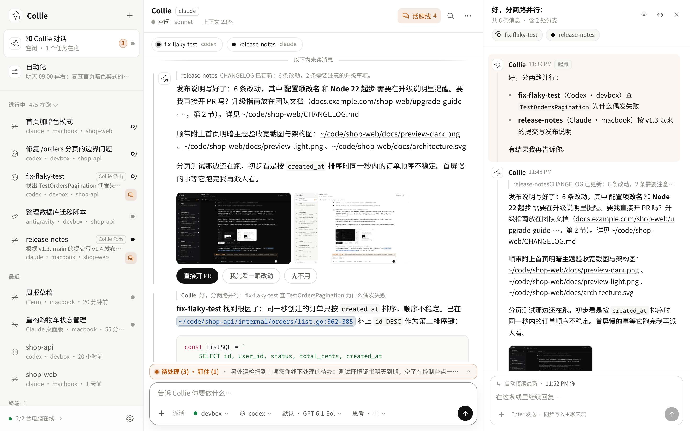
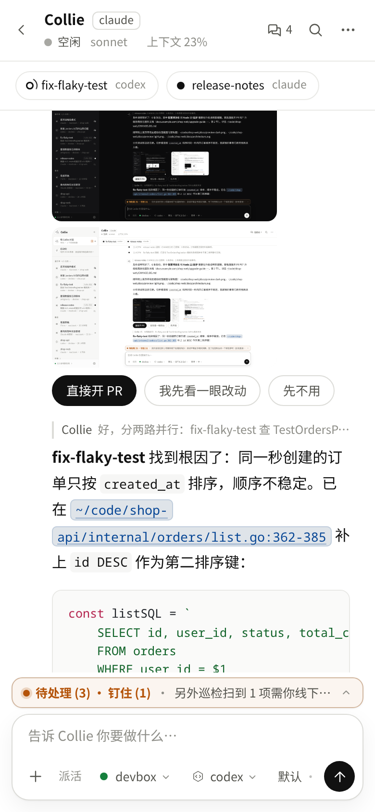
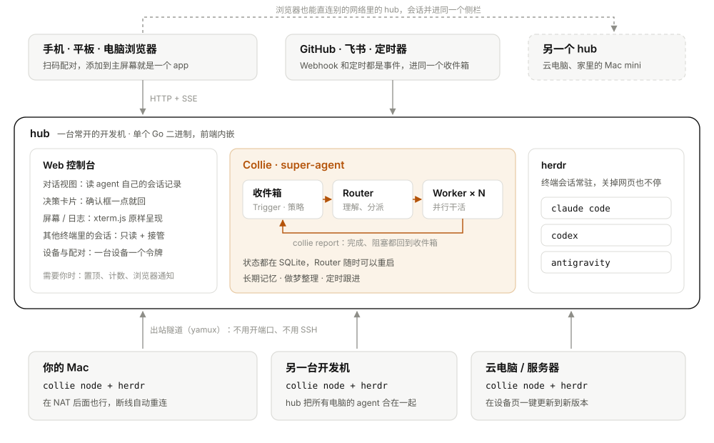

<p align="center"></p>

<h1 align="center">Collie</h1>

<p align="center"><sub>养一只边牧，放牧一群 Agent</sub><br>
<b>买了 20x AI 订阅，别只跑出 1x 效率——让 Collie 把额度跑成 20x 产出</b><br>
开源自托管 Super Agent · Antigravity (Gemini) · Claude Code · Codex · Cursor — 一个人并行推进十几条线，做完只端 3 行结论和一键决策选项。</p>

<p align="center">
<a href="https://lihuanyu0w0.github.io/collie/demo/"><b>▶ 10 秒在线体验</b></a> ·
<a href="https://www.bilibili.com/video/BV1a41EziEsE/"><b>▶ 完整介绍视频 (B 站)</b></a> ·
<a href="https://lihuanyu0w0.github.io/collie/">主页</a> ·
<a href="#快速开始">30 秒快速开始</a> ·
<a href="https://github.com/lihuanyu0w0/collie/releases">下载</a> ·
<a href="README.md">English</a> | <b>中文</b>
</p>

<!-- 首屏精华演示动图 -->
<p align="center">
<a href="https://lihuanyu0w0.github.io/collie/demo/">
  
</a>
</p>

<p align="center">
<b><a href="https://www.bilibili.com/video/BV1a41EziEsE/">▶ 点击观看 3 分钟完整介绍视频（B 站）→</a></b>
</p>

> **单开 Antigravity 是单兵，套上 Collie 才是你的 Gemini 专武**——把多终端并行、长任务盯盘和手机指挥全接管（同样原生支持 Claude Code、Codex 与 Cursor）。

花钱买了 **Claude Max 20x**、**Codex Pro 20x** 这类高配订阅，却还守着单个终端一次盯一个 Agent，跑出来的依然是 1x 效率。**Collie** 是一个开源自托管的 **Super Agent**，让你真正把 **20x 额度跑成 20x 产出**——用一个统一工作台把各台电脑上的 Antigravity、Claude Code、Codex、Cursor 全部收编（告别在终端窗口与各种 Agent 桌面端 App 间来回切换，同时保留随时接管本机已有桌面/CLI 会话的能力）：一个人同时推进**十几条并行线**（调研、改代码、盯长任务、发版一起跑），Collie 负责并行派活、盯进度、遇错自愈与定时巡检，**做完只把 3 行结论和 2–4 个一键决策选项端到你面前**，你只做关键拍板的那几步。因为 Collie 只有一套**纯 Web UI**（手机加到主屏幕即 PWA），手机和电脑是完全一致的完整体验——发需求、看结论、点选项、翻话题抽屉、看图片和报告，**通勤、外出、开会根本不用背电脑**。

> Collie 是一只边牧（border collie）：[herdr](https://herdr.dev) 让终端稳稳跑着，Collie 帮你放牧一群 Agent。

## 为什么用 Collie

- **不止终端，连各种 Agent 桌面端 App 都不用开了** — 告别在终端、Claude 桌面端、Codex 桌面端、Antigravity 桌面端之间来回切窗口。一个统一工作台把所有电脑上的 Agent 全部收编并行干活，遇错先重试换路，做完只端上 3 行结论和 2–4 个拍板选项（如「直接开 PR / 我先看一眼改动 / 先不用」）。
- **纯 Web UI 全端一致，像聊天软件协作，出门根本不用背电脑** — 手机（加主屏即 PWA）和电脑共用同一套完整工作台，不是阉割版遥控器：引用回复、**Pin 置顶**关键结论与待办、多任务独立**话题抽屉**、看图看报告、**跨端已读/未读同步与未读边界锚定**——通勤开会一部手机就能把活干完。
- **事件自动找上门，经验越攒越厚** — 接入 **GitHub**（PR 评审、`@提及` 与 CI 失败自动只读调研，把结论和一键合并/修复选项推给你）、**飞书 / Lark 机器人**（零公网 WebSocket 长连接双向卡片，在熟悉的聊天软件里就能派活收汇报）、定时巡检，以及每晚自动整理的长期记忆（**dream**）。
- **跨电脑零端口互联，不配 SSH** — Mac、Linux、WSL2 与云主机通过出站多路复用隧道（`yamux`）连到一个 hub，原生支持 IPv4 与纯 IPv6 双栈自动发现；不开端口、在 NAT 后面也能用，多套孤立网络还可聚合多个 hub。
- **随时钻进单个 Agent，旧会话也能一键接管** — 想看细节随时点进结构化原生对话记录，或一键切回实时 `xterm.js` 终端画面（遇到终端确认框也能顺手点过）；自动发现 iTerm、VS Code、tmux、SSH 与桌面端已开的会话，实时查看或一键接管。
- **单二进制 30 秒跑起，数据全在你手里** — 单个 Go 二进制 + SQLite + 全内嵌前端（零外部 CDN、不经第三方云）。每台设备独立可撤销令牌，一键全端滚动升级不打断在跑任务，记忆支持一键 ZIP 导出导入迁移。

<table>
<tr>
<td width="64%">
<picture>
  <source media="(prefers-color-scheme: dark)" srcset="docs/img/thread-dark.png">
  <source media="(prefers-color-scheme: light)" srcset="docs/img/thread-light.png">
  
</picture>
<br><sub><b>聊天式协作</b>：未读边界锚定、一键决策选项、Pin 待处理条与可调宽话题抽屉</sub>
</td>
<td width="18%">
<picture>
  <source media="(prefers-color-scheme: dark)" srcset="docs/img/phone-decision-dark.png">
  <source media="(prefers-color-scheme: light)" srcset="docs/img/phone-decision-light.png">
  
</picture>
<br><sub><b>手机端</b>：点一下拍板</sub>
</td>
<td width="18%">
<picture>
  <source media="(prefers-color-scheme: dark)" srcset="docs/img/phone-thread-dark.png">
  <source media="(prefers-color-scheme: light)" srcset="docs/img/phone-thread-light.png">
  
</picture>
<br><sub><b>话题抽屉</b>：并行任务不串台</sub>
</td>
</tr>
<tr>
<td width="50%" colspan="1">
<picture>
  <source media="(prefers-color-scheme: dark)" srcset="docs/img/integrations-dark.png">
  <source media="(prefers-color-scheme: light)" srcset="docs/img/integrations-light.png">
  
</picture>
<br><sub><b>事件自动上门</b>：飞书 / Lark 双向卡片、GitHub PR / CI 调研与可插拔 CLI 托管源</sub>
</td>
<td width="50%" colspan="2">
<picture>
  <source media="(prefers-color-scheme: dark)" srcset="docs/img/agent-dark.png">
  <source media="(prefers-color-scheme: light)" srcset="docs/img/agent-light.png">
  
</picture>
<br><sub><b>随时深入单会话</b>：直读原生对话与改动步骤，本机旧会话一键接管</sub>
</td>
</tr>
</table>

更多截图：[长期记忆与夜间整理](docs/img/memory-light.png) · [实时终端画面](docs/img/screen.png) · [设备与配对](docs/img/devices.png) · [10 秒免安装在线体验](https://lihuanyu0w0.github.io/collie/demo/)

## 快速开始

支持 macOS、Linux（`amd64` / `arm64`）与 Windows（**WSL2**）。一行安装命令自动校验 SHA-256、安装到 `~/.local/bin/collie`、在缺少 [herdr](https://herdr.dev) 时一并装好，并注册后台服务（macOS 用 `launchd`，Linux 用 `systemd --user`）。之后重跑同一条命令就是原地升级。

> **Windows（WSL2）**：直接在 **WSL2（Ubuntu / Debian）** 终端内运行下面同一条命令即可（开箱复用 Linux 二进制）；纯查看或拍板时，直接用 Windows Chrome / Edge 打开 hub 网页即可。

**1. 常开电脑：30 秒起一个 hub**

```bash
curl -fsSL https://lihuanyu0w0.github.io/collie/install.sh | sh -s -- hub
```

启动时自动探测本机 IPv4 / 纯 IPv6 地址并打印手机配对二维码；地址认不准时加 `--url http://<主机 IP>:7788`（或 `http://[<IPv6>]:7788`）。Linux 若希望退出登录后继续运行，执行一次 `loginctl enable-linger`。

**2. 手机：扫码配对**

扫终端里的二维码（或在「设备 → 连接手机或平板」里扫），随后「添加到主屏幕」即可像原生 app 一样使用（iOS 建议用 Safari 添加到主屏幕以保持完整 PWA 会话）。已读/未读进度与待拍板选项会在手机和电脑间自动同步。

**3. 其他电脑：加入舰队**

在 hub 的「设备 → 连接一台电脑」里获取配对码（或在 hub 上运行 `collie pair --computer`），然后在那台电脑上运行：

```bash
curl -fsSL https://lihuanyu0w0.github.io/collie/install.sh | sh -s -- node --hub http://<hub>:7788 --code <配对码>
```

node 会主动出站连上 hub（不开端口、不配 SSH），把地址和独立令牌存进 `~/.collie/node.json` 并注册后台服务。所有电脑合进同一个侧栏，远端窗格带机器后缀（如 `w1:p1@mac`）。

> **集成与安全说明**：安装脚本会为未安装项自动补装 Claude Code 与 Antigravity 的 herdr 集成，不会覆写已有配置；**Codex 默认跳过全局 hook**（Collie 无需改动 `~/.codex/hooks.json` 即可正常发现、对话和恢复 Codex，如确需安装可传 `COLLIE_INSTALL_CODEX_HOOK=1`）。局域网默认明文 HTTP，跨网络使用请置于 Tailscale / VPN 或 HTTPS 反向代理后（配合 `--url https://…`）。

**一键全端更新**：有新版本发布时，点击侧栏底部或「设备」页的**一键更新**，或在终端直接运行 `collie update`（支持别名 `collie upgrade`）：`collie update --check` 只读检查版本，`collie update` 原子更新本机并平滑重启后台服务，`collie update --all` 按「先远端 node（自动复用 Hub 隧道中转兜底）、后 hub」顺序更新全端，不打断正在跑的 Agent。

## 架构

<p align="center">
<picture>
  <source media="(prefers-color-scheme: dark)" srcset="docs/img/architecture-dark.svg">
  <source media="(prefers-color-scheme: light)" srcset="docs/img/architecture-light.svg">
  
</picture>
</p>

一个 **hub** 放在常开的电脑上；其他电脑运行 `collie node` 主动连上 hub；手机、平板、浏览器只连 hub。Agent 本身跑在 [herdr](https://herdr.dev) 里，关掉网页也不会停。

## Super Agent 是怎么运转的

```text
          ┌──────── 你（Web 对话 / 飞书·Lark / GitHub / 定时巡检 …）
          ▼
   Trigger 收件箱 ── 快路径：来源策略 respond / candidate / ignore
          │
          ├── 订阅了线程的 worker ◀── 直达，不经过 Router
          ▼
   Router（常驻 session：拆活、跟进、只端 3 行结论 + 一键选项）
          │  collie spawn / send / reply / timer …
          ▼
   Worker × N（跨电脑隔离的 herdr 工作区并行干活，collie report 回报）
```

- **Router / Worker 分层** — Router 只负责和你沟通、拆活与汇总（回复默认精炼，字数预算可调），用轻量快速模型就够，把最强模型留给真正干活的 Worker。
- **统一收件箱与线程订阅** — 对话、GitHub PR / CI 事件、飞书消息、Webhook、定时巡检和 Worker 回报统一进入收件箱。未经请求的外部事件默认走 `candidate`（命中你的规则或记忆才行动）；订阅了 PR 或话题线程的 Worker 直接收到后续跟进。
- **长文自动溢出（Inline & Spill）** — 超过 700 字的事件只内联摘要，完整内容按需通过 `collie show <id>` 拉取，全链路带 ID 可回溯又不撑爆上下文。
- **卡点自愈与夜间整理（dream）** — Worker 长时间无进展会自动触发提醒，Collie 优先重试或换思路，只有值得你拍板的决定才推给你。所有状态落在 SQLite，长期记忆落在 `~/.collie/router/memory/`，每晚自动整理，支持一键 ZIP 导出导入。

---

## 进阶与参考

<details>
<summary><b>多 hub 聚合、Mac 独立 app 与从源码安装</b></summary>

### 多个 hub

几台电脑在互不相通的网络里（办公开发机、云主机、家里的 Mac mini）时，每个网络各跑一个 hub，再在主 hub 的「设备 → 其他 hub」里粘贴对方 hub「连接手机或平板」下的链接。之后会话会并入同一个侧栏（标注来源 hub），对话、发消息、停止都直接发往对应 hub。

- hub 之间无需互通，只要浏览器能访问每个 hub；
- 对方 hub 需 `v0.2.4+`（跨站令牌鉴权，不依赖 Cookie）；HTTPS 页面无法直连明文 HTTP hub。

### 在 Mac 上装成独立 app

加入了 hub 的电脑会在本机 `http://127.0.0.1:17788` 提供同一套界面（转发到 hub）。浏览器视 `127.0.0.1` 为安全来源，用 Chrome 打开并配对一次后，点地址栏右侧「安装 Collie」即可放进 Dock 并开启桌面通知。换端口：`collie node --ui 127.0.0.1:<端口>`；关闭：`--ui off`。

### 命令行升级与从源码安装

终端直接原地升级（自动校验 SHA-256、原子替换二进制，并平滑重启正在运行的 `systemd --user` / `launchd` 服务）：

```bash
collie update --check   # 只读检查当前版本与最新版本
collie update           # 更新本机（支持 collie upgrade 别名；加 --force 可强制重装）
collie update --all     # 一键先升级所有在线远端节点，最后升级 hub
```

也可以重跑安装脚本手动升级（node 无需重新配对；hub 如曾传过 `--url` 等参数请一并带上）。

从源码构建安装（需要 **Go 1.25+** 和 `git`）：

```bash
git clone https://github.com/lihuanyu0w0/collie.git ~/collie && cd ~/collie
sh docs/install.sh hub                                          # 做 hub
sh docs/install.sh node --hub http://<hub>:7788 --code <配对码>   # 加入电脑
```

只装二进制、不装服务：`curl -fsSL https://lihuanyu0w0.github.io/collie/install.sh | sh`。指定版本或目录：`COLLIE_VERSION=v0.2.85`、`COLLIE_BIN_DIR=…`。脚本见 [docs/install.sh](docs/install.sh)。

</details>

<details>
<summary><b>外部事件接入（GitHub、飞书 / Lark、可插拔 CLI 源与 Webhook）</b></summary>

在 **自动化 → 接入** 中配置（密钥独立保存在 `0600` 权限的 `~/.collie/secrets.json`，前端零回显）：

- **GitHub 与可插拔代码托管源** — 内置 GitHub 适配器，按 `notify` / `advise` / `agent` 三档模式追踪 PR 评审、`@` 提及与 CI 失败并维持稳定线程；也可在 `~/.collie/providers/*.json` 放入自定义 CLI provider 接入任意托管平台。
- **飞书 / Lark 零公网长连接** — 原生 WebSocket 长连接支持双向对话与交互式决策卡片，无需公网回调地址；在群聊中直接 `@Collie` 且未引用父消息时，若已为应用开通可选的 `im:message.group_msg` 权限，会自动附带最近群聊上下文（未开通则优雅降级为原消息）。同时也兼容事件订阅 Webhook（`/hooks/feishu?key=…`，已自动处理 `url_verification`）。
- **GitHub 与通用 Webhook** — 在「自动化 → 接入」复制地址：
  - GitHub：`/hooks/github?key=…`（Content type 选 `application/json`）
  - 通用：`POST /hooks/<source>?key=…`，JSON `{"text","thread","from","id"}`，支持 `X-Idempotency-Key` 去重。Webhook 立即返回 `202`，过滤与路由在收件箱异步完成。
- **Outbox 通知** — 可选飞书 / Lark 或 Slack 通知，每 20 秒合并发送，安静模式下只在需要你时推送。

</details>

<details>
<summary><b>直接管 Agent、接管其他终端会话与 herdr 兼容说明</b></summary>

- **原生会话解析** — 直接读取 Claude（`~/.claude/projects/*/<id>.jsonl`）、Codex（`~/.codex/sessions/**/rollout-*.jsonl`）、Antigravity（`~/.gemini/antigravity-cli/brain/<id>/…/transcript.jsonl` 及桌面版目录）。对未向 herdr 上报会话 id 的 Agent，按工作目录与启动时间精确配对并独占认领，配不上时退回终端输出，绝不串会话。
- **终端确认框辅助** — 直接钻进某个 Agent 时，如果终端停在确认菜单，Collie 会自动识别编号菜单与光标菜单并转成点选卡片，随时可展开原始终端核对。
- **其他终端里的会话** — hub 和每台已连接电脑都会自动发现 iTerm、VS Code、tmux、SSH 及桌面应用里直接运行的会话，支持实时只读查看，也可一键「在 herdr 里接管」（平滑中断原进程并以 `claude --resume` / `codex resume` / `agy --conversation` 原地接续）。
- **浏览器偏好设置** — 侧栏底部齿轮（仅影响当前浏览器）：主题（跟随系统 / 浅色 / 深色）、字号、默认视图（对话 / 屏幕）、Enter 或 ⌘Enter 发送、折叠连续工具步骤、浏览器通知。
- **herdr 0.8 / 0.9 兼容** — 同时兼容两个版本：在 `herd.db` 中持久化 Agent 名称，0.8 卡在 `launch_pending` 时自动回退直贴输入，并巡检屏幕捕获目录信任确认框。

</details>

<details>
<summary><b>完整 CLI 参考</b></summary>

Router、Worker 与用户共用同一个 `collie` 二进制（在已加入 hub 的电脑上会自动读取 `~/.collie/node.json` 转发到 hub）：

```bash
collie reply [--re ID] [--opt "选项"]... [--check] "…"        # Router → 你
collie spawn [-kind claude] [-machine mac] [-cwd ~/x] \
             [-model ID] [-effort E] [-name n] [-thread t] [-subscribe] "任务"
collie send <worker> "追加指令"                               # 给运行中的 worker 发消息
collie report "结果或 BLOCKED: 需要你决定的问题"               # worker → Router（按 HERDR_PANE_ID 识别）
collie answer <worker> <编号 | 选项关键词 | esc>              # 回复 worker 的确认框
collie subscribe [--off] <worker> <thread>                   # 将线程后续事件直达指定 worker
collie stop <worker>                                         # 停止 worker
collie show <trigger-id | thread | worker>                   # 取回被截断的完整内容
collie list                                                  # 查看 worker、线程与定时器
collie timer add [--thread T] [--to worker] "<时间表达式>" "内容"
collie timer ls | rm <id>
collie memory export [file.zip]                              # 导出 Router 记忆为 ZIP
collie memory import [--replace] <file.zip>                  # 合并或覆盖导入记忆 ZIP
collie say "…"                                               # 以你的身份发给 Router
collie hook <source> "…"                                     # 模拟注入一个外部事件
collie pair [--computer]                                     # 打印手机配对二维码 / 电脑加入命令
collie node [--hub URL --code CODE] [--name mac]             # 把这台电脑接到 hub
collie update [--check | --all | --force]                    # 检查或更新 collie（支持 upgrade 别名）
```

</details>

<details>
<summary><b>参数、环境变量与 <code>~/.collie</code> 目录布局</b></summary>

`collie`（等同 `collie serve`）启动 hub，默认监听 IPv4 / IPv6 双栈。前端（含 `xterm.js` 与离线 KaTeX）全部内嵌在二进制里，离线或局域网无需访问 CDN。

| 参数 | 环境变量 | 默认值 |
|---|---|---|
| `-addr` | `COLLIE_ADDR` | `:7788` |
| `-socket` | `HERDR_SOCKET_PATH` | `~/.config/herdr/herdr.sock` |
| `-token` | `COLLIE_TOKEN` | 自动生成（主令牌） |
| `-url` | `COLLIE_URL` | 自动探测本机 IPv4 / IPv6 地址，用于二维码与配对命令 |
| — | `COLLIE_HOME` | `~/.collie` |

> 拿到令牌的人就能控制你的终端。主令牌仅自己保管；其他设备一律通过配对获取独立可撤销令牌（电脑令牌只能建隧道与调 CLI，打不开 Web 控制台）。

| `~/.collie` 下路径 | 内容 |
|---|---|
| `herd.db` | SQLite（WAL）：Trigger 收件箱、线程、worker、对话记录、定时器、设置、已配对设备（仅存令牌哈希） |
| `node.json` | 仅 node：hub 地址、本机 id 与令牌 |
| `token` / `addr` | 访问令牌与当前监听地址（供本地 CLI 使用） |
| `secrets.json` | 外部接入凭据（`0600` 权限，界面零回显） |
| `providers/` | 可选的本地自定义 CLI 代码托管源定义（`*.json`） |
| `router/` | Router 工作目录：`ROUTER.md`（同步生成 `CLAUDE.md` / `AGENTS.md` / `GEMINI.md`）、`memory/`（长期记忆）与 `dreams/` |

</details>

<details>
<summary><b>从源码构建与代码结构</b></summary>

需要 **Go 1.25+**：

```bash
go build -o bin/collie .
./bin/collie                       # 监听 :7788（IPv4/IPv6 双栈）
go test ./...
scripts/release.sh v0.1.0 --dry    # 交叉编译四个平台到 dist/
```

```text
浏览器 ──HTTP + SSE──▶ collie hub（单个 Go 二进制，内嵌 web/）──NDJSON──▶ herdr.sock
                         ├─ 会话记录增量解析（JSONL）
                         ├─ Super-agent：收件箱 → 路由 → Worker（SQLite）
                         ├─ 外部接入：GitHub / CLI Provider / 飞书长连接 / Webhook
                         └─ yamux 隧道 ◀── collie node（herdr 流 + 本机 pane API）
```

```text
main.go              入口：版本号与 collie.Main
internal/collie/     hub、node、super-agent、外部接入、记忆导入导出与 CLI
web/                 原生 HTML/CSS/JS 前端，无构建步骤，go:embed 打进二进制
docs/                install.sh、双语 GitHub Pages 主页、demo/ 与截图
scripts/release.sh   四平台交叉编译与 Draft 原子发布
scripts/demo.sh      构建在线体验（docs/demo/）：真实前端 + 模拟数据
```

</details>
